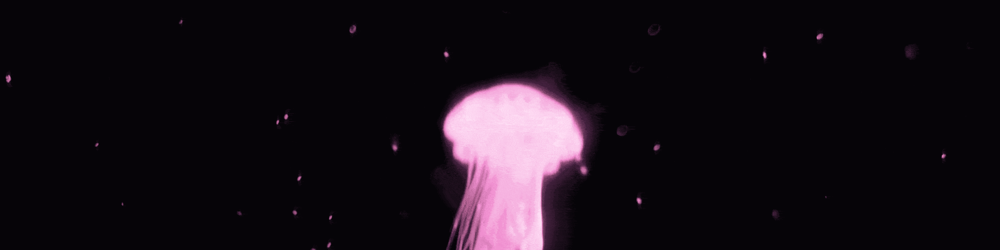
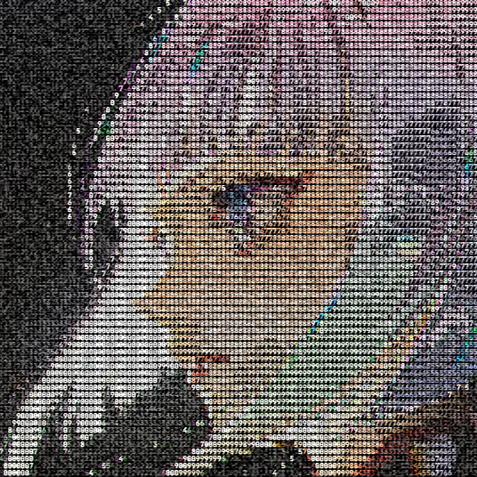
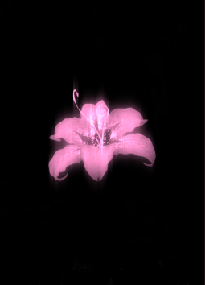

<div align="center">

<!-- HEADER: 1600x400 (4:1). assets/header.gif -->


<a href="https://github.com/sooha-cs">
  
</a>

<br/><br/>


[](https://github.com/sooha-cs?tab=followers)
[](https://github.com/sooha-cs)

<br/>

</div>


## ✦ About Me

<!-- ASCII art floats to the right of the text. Resize by changing width (px). Fits best between 260 and 340. -->


*get to know me*

I'm a cybersecurity student who's curious about how **things actually work under the hood**.
Right now I'm deep-diving into **networking**, **assembly concepts** and **log analysis**.

- 🎓 **Year:** 3rd
- 🔬 **Focus:** Networking · RE
- 🎯 **2026 goal:** present a paper at a conference
- 🦫 **Fun fact:** likes capybaras

<details>
<summary><b>✦ my philosophy</b></summary>
<br/>

Understand the system first, then break it, then write about it.
<br/>

</details>

[**SKILLS**](#-skills) &nbsp;·&nbsp; [**PROJECTS**](#-projects) &nbsp;·&nbsp; [**CERTS**](#-certificates--achievements) &nbsp;·&nbsp; [**CONTACT**](#-contact)

<br clear="all" />


## ✦ Skills

<!--
=====================  BADGE TEMPLATE (copy a line, tweak, paste)  =====================


NAME  -> text on the badge. Spaces = %20, dash = --
SLUG  -> lowercase icon name from https://simpleicons.org  (e.g. python, gnubash, git)
        No icon exists (Nmap, Hydra, Ghidra...)? Delete "&logo=...&logoColor=..." entirely.
COLOR -> 4A2A44 Plum (default) | F090D0 Flower Pink (use for "favourites") | A58FA0 Muted
If a logo shows blank, the slug was renamed: search simpleicons.org again, or drop the logo.
Shrink them: change style=flat-square to style=flat-square
==========================================================================================
-->

<!-- Flower sits to the left of the badges. Drop your PNG at assets/flower.png. Use align="right" to flip sides. -->


**`// languages`**<br/>


<!-- add language here -->

**`// operating systems`**<br/>


<!-- add OS here -->

**`// tools & platforms`**<br/>


[](https://tryhackme.com/p/s00ha)
[](https://pwn.college)

<!-- add tool here -->

<br clear="all" />


## ✦ Projects

<div align="center">

*my latest work and research*

<a href="https://github.com/sooha-cs/SecuIntell"></a>
<a href="https://github.com/sooha-cs/pass-pwned"></a>
<a href="https://github.com/sooha-cs/Thr34t-M4pp1ng-bcs-why-n0t"></a>

</div>

<details>
<summary><b>✦ json-c-fuzzing: what / how / run</b></summary>
<br/>

**What:** Building a correct, fast, reproducible fuzzing pipeline
**How:** Coverage-guided fuzzing of json-c with AFL++ and AddressSanitizer

```bash
git clone https://github.com/sooha-cs/json-c-fuzzing && cd json-c-fuzzing
```

</details>

<details>
<summary><b>✦ PassPwned: what / how / run</b></summary>
<br/>

**What:**  Investigating whether common password-strength checkers detect sequential and pattern-based weaknesses
**How:** Using a subset of ~10,000 passwords from the RockYou leak

```bash
git clone https://github.com/sooha-cs/password-strength-analysis && cd password-strength-analysis
```

</details>

<details>
<summary><b>✦ Thr34t-M4pp1ng-bcs-why-n0t: what / how / run</b></summary>
<br/>

**What:** Reconstructing the attack lifecycle of the 2026 Canvas breach
**How:** Reviewed public incident reports and disclosures related to the Canvas breach

```bash
git clone https://github.com/sooha-cs/Thr34t-M4pp1ng-bcs-why-n0t && cd Thr34t-M4pp1ng-bcs-why-n0t
```

</details>


## ✦ Certificates & Achievements

<div align="center">

<!-- Replace the rows with real certs / CTF ranks. Delete the section if you'd rather not show it. -->

| Certificate / Experience | Issuer | Year |
|:---|:---:|:---:|
| Cybersecurity Intern | Palo Alto Networks Cybersecurity Academy | 2026 |
| Google Solutions Challenge | Google x H2S | 2026 |
| Research paper (submitted) | TBA | 2026 |

</div>


<!--
## ✦ Stats

<div align="center">


&nbsp;


<br/><br/>


<br/><br/>


</div>


-->

## ✦ Quote of the Day

<div align="center">

<!-- Random quote, refreshes on page load. Colour params may be ignored by the service; if so, the radical theme still looks close. -->


</div>


## ✦ Contact

<div align="center">

*let's talk research, networking or capybaras*

[](https://github.com/sooha-cs)
[](https://x.com/hvnlyhs)
[](https://discord.com/users/soohaa.fps)
[](https://tryhackme.com/p/s00ha)

<br/>


<sub>✦ crafted with ♥ and too much caffeine · always open to interesting conversations ✦</sub>

</div>
